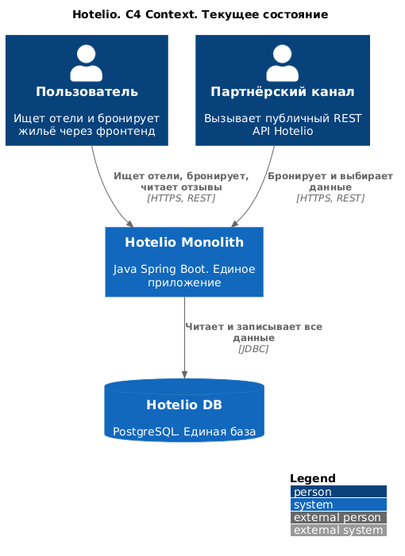
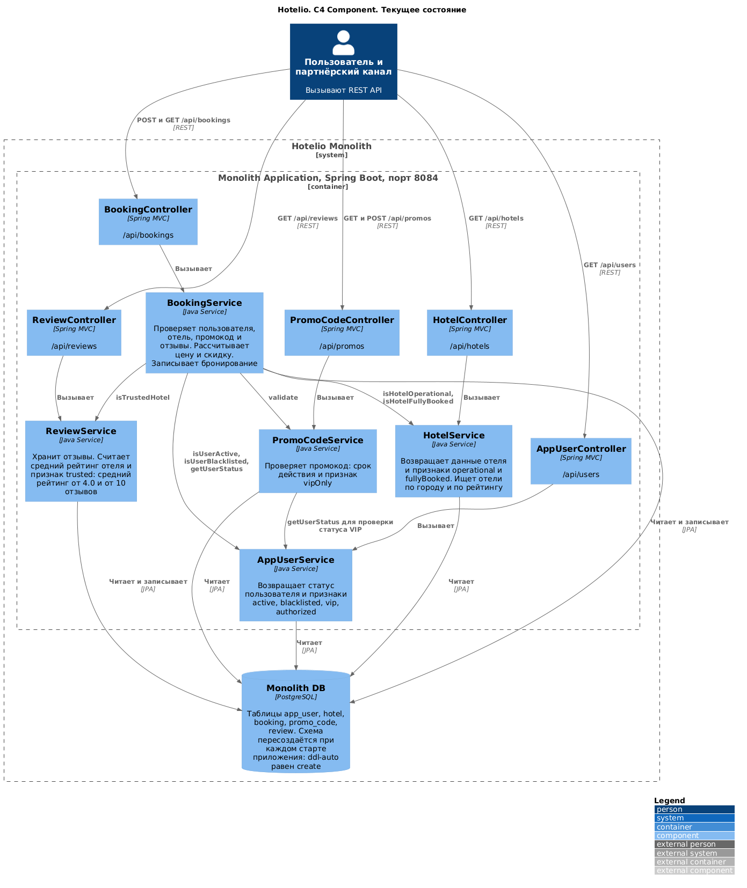
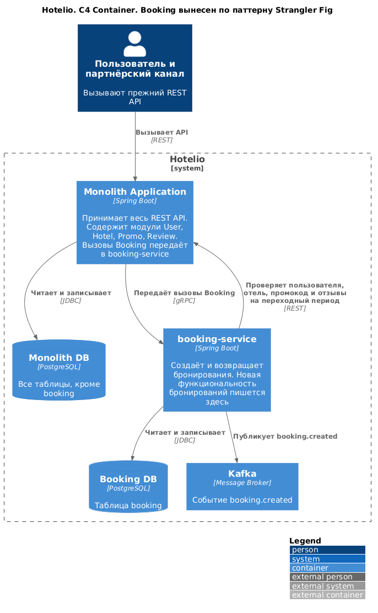

## Задание 1 Проработка миграции от монолита к микросервисам

# Решение

## Диграммы

### C4 Context (AS IS)


### C4 Container (AS IS)


### C4 Container (TO BE)


## ADR

[Описание ADR](results/ADR.md)

## Логи тестов

[Логи](results/test-log.txt)

## 🛠️ Подготовка окружения

1. Установите Docker и Docker Compose  (это уже есть)
2. Создайте Docker-сеть (если ещё не создана):
   ```bash
   docker network create hotelio-net
   ```
3. Для удобства просмотра кода может понадобиться:
	a. Установите JDK 17  
	b. Установите Gradle (или используйте встроенную в Idea)
	c. Установить Idea или Visual Studio Code (это уже есть)
---

## 🚀 Сборка приложения (при необходимости)
```bash
./gradlew build
```
---

## 🚀 Запуск приложения

```bash
docker-compose up -d --build
```

Проверьте работоспособность:

```bash
curl http://localhost:8084/bookings
```

---

